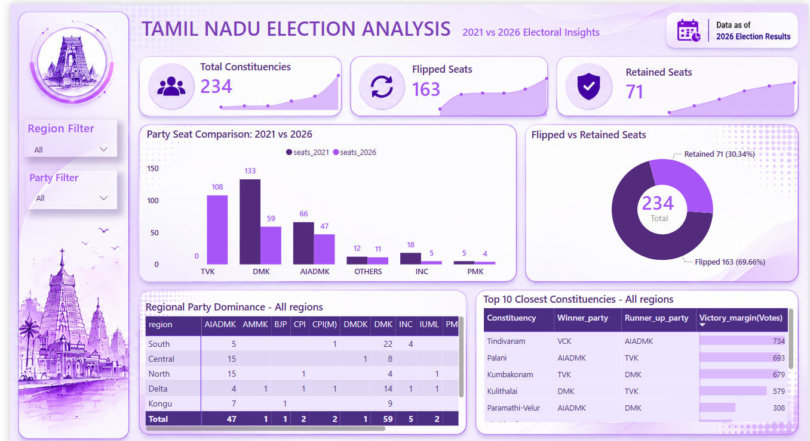

# Tamil Nadu Election Analysis — AtliQ Media

A Codebasics portfolio case study using the supplied 2021 and 2026 election-result datasets to explain changes across 234 constituencies. Findings below describe the project dataset; they are not an independent verification of official election results.



## Open the project

| Deliverable | Link |
| --- | --- |
| Live dashboard | [Power BI](https://app.powerbi.com/view?r=eyJrIjoiMDQ2MGIwMjMtN2NjZS00NTlhLTkzOTQtNWQ0YjAwNmRhZmQyIiwidCI6ImM2ZTU0OWIzLTVmNDUtNDAzMi1hYWU5LWQ0MjQ0ZGM1YjJjNCJ9) |
| Presentation PDF | [Read the deck](TN-election-2026-project/deck/TN%20election%20analysis.pdf) |
| Editable presentation | [PowerPoint](TN-election-2026-project/deck/TN%20election%20analysis.pptx) |
| Dashboard workbook | [Power BI file](TN-election-2026-project/dashboard/TN_election_analysis.pbix) |
| Research dossier | [Word document](TN-election-2026-project/documentation/Research_Dossier_Decoding_2026_TN_Election.docx) |
| Video presentation | [Watch](https://drive.google.com/file/d/1cBVZYQGQbDDC4ljkbggf9wyPiIlPCaC5/view) |

## Analysis questions

1. How many constituencies changed winning party?
2. Where was that change concentrated?
3. How close were the winning margins?

## Findings in the project data

| Measure | Value |
| --- | ---: |
| Constituencies analysed | 234 |
| Changed winning party | 163 |
| Retained winning party | 71 |
| Change rate | 69.66% |
| Largest party transition | DMK to TVK, 65 seats |
| Closest winning margin | 1 vote |

Chennai Metro showed the highest regional change rate at 93.8%, followed by Kongu at 81.8%. Delta showed a lower rate of 45.5%. These comparisons show that changes were concentrated differently across regions. They do not explain voter motivations.

## My workflow

- Checked constituency keys and reconciled totals in SQL.
- Compared winning parties between the two years.
- Calculated victory margins from winner and runner-up votes.
- Built a Power BI dashboard and a stakeholder presentation connecting constituency changes, regional patterns and close contests.

A changed constituency means its winning party differs between years. A change rate is not a vote-share swing or the percentage of individual voters who changed their choice.

## Research reports

- [Geographic story](TN-election-2026-project/documentation/Q1_Geographic_Story_Research_Report.docx)
- [Constituency change story](TN-election-2026-project/documentation/Q2_Flip_Story_Research_Report.docx)
- [Victory margin story](TN-election-2026-project/documentation/Q6_Margin_Story_Research_Report.docx)

## Actual repository structure

```text
TN-election-2026-project/
├── data/           # Supplied results, constituency mapping and assignment documents
├── dashboard/      # TN_election_analysis.pbix
├── deck/           # Presentation PDF and PPTX
├── documentation/  # Research dossier and three detailed reports
├── exports/        # constituency_flips.csv, margins_2026.csv, seat_comparison.csv
├── images/         # Dashboard and slide previews
└── sql/            # 01_database_setup.sql.txt
```

The SQL setup file is stored with a `.sql.txt` extension; open it as text and review it before running it in your SQL environment. Database connections in the PBIX may need to be updated for local use.

## Interpretation

This is descriptive analysis of the supplied challenge data. It does not establish why voters changed their choices, measure campaign effects or predict future results.

## Tools

SQL · Power Query · Power BI · DAX · PowerPoint

**Narmatha Annadurai** — [Portfolio](https://codebasics.io/portfolio/Narmatha-Annadurai) · [LinkedIn project post](https://www.linkedin.com/posts/narmatha-annadurai_decoding-the-2026-tamil-nadu-assembly-election-activity-7468391305660809217-HSyQ)
